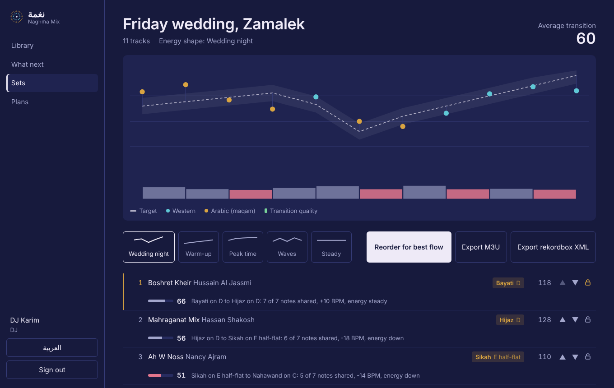
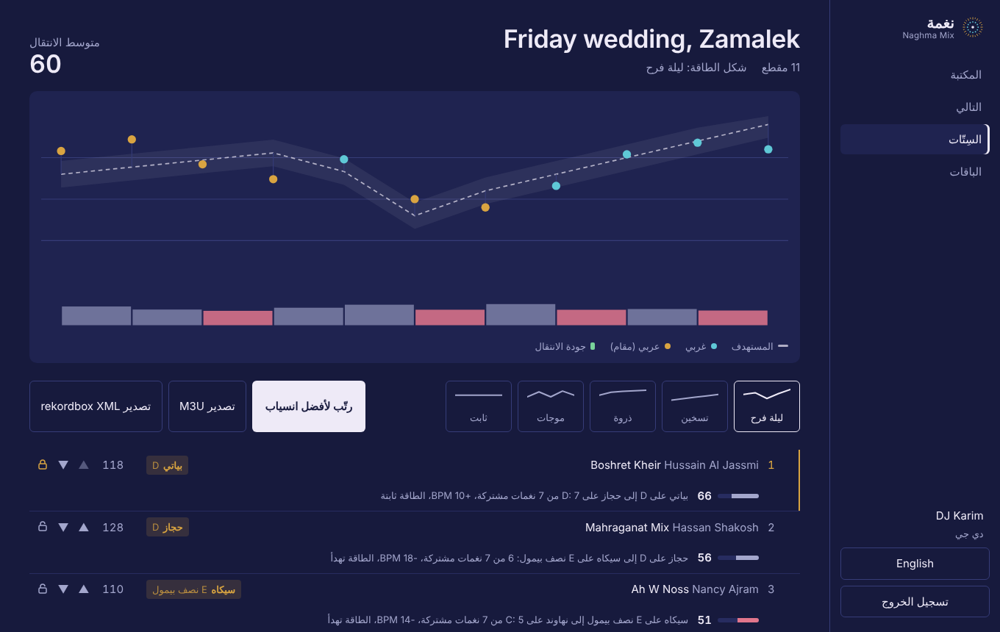

# Naghma Mix

[](https://github.com/amohsen98/naghma-mix/actions/workflows/ci.yml)

DJ set-prep for Western and Arabic music. Upload your library and every track gets tagged with BPM, energy and key (Camelot). Arabic tracks also get their **maqam and tonic**, quarter tones included. The app then suggests what to play next and orders whole sets that flow, for Western, Arabic or mixed crowds.

```
 browser ──REST──▶ nginx ──▶ accounts-service  (Quarkus)  JWT, plans, billing
    │                    ├─▶ catalog-service   (Quarkus)  uploads, tracks, tags, corrections
    │                    └─▶ mix-service       (Quarkus)  transition scoring, next track, sets, exports
    │                               │  outbox ─▶ Kafka analysis.jobs ─▶ worker × N (Python)
    │                               ◀── Kafka analysis.results ◀────────┘   BPM, key, energy, maqam
    └──presigned PUT──▶ MinIO / S3 ◀──────────────── worker downloads, then deletes the audio
                     PostgreSQL: one schema per service (accounts, catalog, mix)
```

| Set view | Arabic |
|---|---|
|  |  |

## Documentation

- [Architecture and design decisions](docs/ARCHITECTURE.md): how analysis, scoring and the data flow work, and why
- [Deployment](docs/DEPLOYMENT.md): free hosting on Oracle Cloud with HTTPS and automatic deploys

## Repository layout

| Path | What it is |
|---|---|
| `backend/accounts-service` | Sign-up/sign-in, RS256 JWTs carrying the plan tier, billing with a pluggable payment gateway |
| `backend/catalog-service` | Two-step presigned uploads with SHA-256 de-duplication and monthly quotas, a transactional outbox to Kafka, idempotent result consumer, tag corrections stored as training feedback |
| `backend/mix-service` | Transition scoring (Camelot + maqam scale overlap), next-track suggestions, set ordering with locked positions, M3U / rekordbox XML export |
| `worker` | Python analysis: librosa beat tracking, Krumhansl key profiles, pYIN melody → pitch-class histogram → maqam template matching; Kafka consumer with retries and a dead-letter topic |
| `web` | React + TypeScript app in English and Arabic (full right-to-left layout) |
| `infra` | JWT key generation; production setup (Caddy, server bootstrap) |
| `.github/workflows` | CI (build and test all parts) and Deploy (Arm64 images to GHCR, rollout over SSH) |
| `docs` | Architecture, deployment guide, screenshots |

## Run everything

Needs Docker with Compose v2.

```bash
docker compose up --build
```

Open http://localhost:8080 and create an account. The first build downloads Maven and npm dependencies and takes a few minutes. The MinIO console is at http://localhost:9001 (`naghma` / `naghma-dev-secret`).

New accounts start on the Free plan. To try the set builder, open **Plans** and upgrade: in development the payment step confirms instantly. Its webhook is still HMAC-signed and verified, so the real flow is exercised.

## Develop one piece at a time

```bash
# infrastructure only
docker compose up -d postgres kafka kafka-init minio keys

# a service with live reload (repeat for catalog-service and mix-service)
cd backend/accounts-service && mvn quarkus:dev

# the worker
cd worker && pip install -r requirements.txt && python -m naghma_worker.main

# the web app on http://localhost:5173 (proxies /api to the services)
cd web && npm install && npm run dev
```

UI work without any backend: `cd web && npm run build && node mock-server.mjs`, then open http://localhost:4173.

## Tests

```bash
sh infra/gen-keys.sh                                                      # JWT keys the services need, once
cd worker && pip install -r requirements.txt pytest && python -m pytest   # 23 tests, synthetic audio
cd web && npm test                                                        # reason wording in EN/AR, formatting
cd backend && mvn test                                                    # domain unit tests + @QuarkusTest (Docker needed for Dev Services)
```

On Docker Engine 29 or newer, run `echo "api.version=1.44" > ~/.docker-java.properties` once, or Dev Services cannot reach Docker.

The worker tests synthesize melodies in each maqam (quarter tones and vibrato included) over a click track. They check maqam, tonic (±20 cents), tonality, BPM (±2%), key detection on chord progressions, and the worker's retry and dead-letter behaviour. No copyrighted audio is needed.

## Analyze your own files (the Gate 1 experiment)

```bash
cd worker
python -m naghma_worker.cli analyze --compact ~/Music/*.mp3
```

To measure accuracy on songs you have labelled, write a CSV with `path,maqam,tonic_note` (tonic like `D` or `E half-flat`) and run:

```bash
python scripts/histogram_experiment.py labels.csv --out report.html
```

The report shows top-1 accuracy, a confusion table and each song's pitch histogram aligned to your labelled tonic. That tells you whether Rast and Bayati really separate on real recordings before you invest more.

## API

| Method & path | Service | Purpose |
|---|---|---|
| `POST /api/auth/register`, `/login`, `/refresh`; `GET/PUT /api/auth/me` | accounts | Accounts and tokens |
| `POST /api/billing/checkout`, `/webhook` | accounts | Upgrade flow |
| `POST /api/uploads` | catalog | Presigned upload URLs; duplicates detected by SHA-256 |
| `POST /api/uploads/complete` | catalog | Confirm uploads and queue analysis |
| `GET /api/tracks?q=&status=&tonality=&page=&size=` | catalog | Library |
| `GET /api/tracks/{id}` | catalog | Detail: maqam candidates, pitch histogram, energy curve |
| `PATCH /api/tracks/{id}/tags` | catalog | Correct tags (kept on re-analysis, logged as feedback) |
| `POST /api/tracks/{id}/reanalyze`, `DELETE /api/tracks/{id}` | catalog | Housekeeping |
| `GET /api/tracks/features?ids=` | catalog | Compact features for the mix service |
| `GET/PUT /api/admin/corrections…` | catalog | Review DJ corrections before training (admin) |
| `GET /api/mix/next/{trackId}?direction=&harmony=&tonic=&tempo=&energy=` | mix | Ranked suggestions with reasons |
| `GET /api/mix/score?from=&to=` | mix | One transition in detail |
| `GET/POST /api/sets`, `GET/PUT/DELETE /api/sets/{id}` | mix | Build, reorder (optimized or manual), lock positions |
| `GET /api/sets/{id}/export?format=m3u\|rekordbox` | mix | Playlist files |

Each service also serves `/q/health`, `/q/metrics` (Prometheus) and OpenAPI at `/api/<prefix>/openapi`.

To make an admin: `UPDATE accounts.users SET admin = true WHERE email = '…';` then sign in again.

## Not done yet

- First real deployment (the pipeline and guide are ready: [docs/DEPLOYMENT.md](docs/DEPLOYMENT.md)).
- A real payment provider for Egypt and the Gulf (`PaymentGateway` is the seam).
- Demucs in the default worker image (it is optional because of its size).
- Transition points on phrase boundaries, previews and stems (V1 in the PRD).
- Rate limiting and a secrets manager for production keys.
